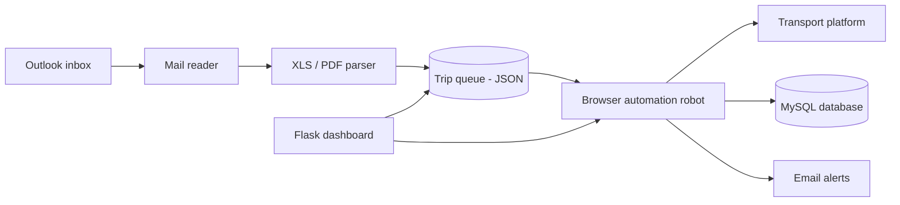

# Freight Operations Automation Robot

A desktop automation system that turns incoming dispatch emails into completed trip records in a transport management web platform, with a live monitoring dashboard.

> The source code is private because it was built for a client. This page describes the architecture and what I built. All example data is fictional.

## The problem

Trip orders arrive by email as spreadsheets and PDFs, and every field (route, carrier, truck, driver, dates, amounts) had to be typed by hand into a web platform.

## What it does

1. **Reads dispatch emails** from Outlook and extracts the attached spreadsheet and PDF documents.
2. **Parses trip data** (route, carrier, truck, driver, dates, amounts) and validates it.
3. **Queues trips** in a persistent JSON queue with retry logic for recoverable errors.
4. **Drives the transport platform's web interface** (login, trip creation, departure, arrival, invoicing) with browser automation.
5. **Syncs results** to a MySQL database and a trip log for auditing.
6. **Sends email alerts** when a trip fails or needs human attention.
7. **Serves a web dashboard** (Flask) to monitor the robot in real time, reprocess failed trips and manage route keys.

## Architecture

## Tech stack

- **Python:** core logic and orchestration
- **Selenium:** browser automation
- **Flask:** monitoring and admin dashboard
- **MySQL:** result storage
- **Outlook COM (pywin32):** mail reading
- **pandas and PDF extraction:** document parsing

## Highlights

- End-to-end flow with no manual data entry.
- Fault tolerance: retryable versus permanent errors, duplicate detection and queue persistence across restarts.
- Operator dashboard: live robot status, failed-trip reprocessing and route key administration.
- Screenshots on failure, structured debug logging and a state manager for post-mortems.

[Back to profile](https://github.com/Ernesto-9)

See more projects on my [GitHub profile](https://github.com/Ernesto-9).
